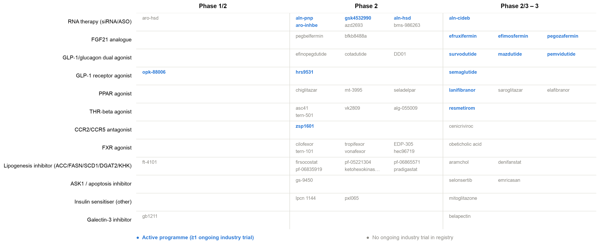
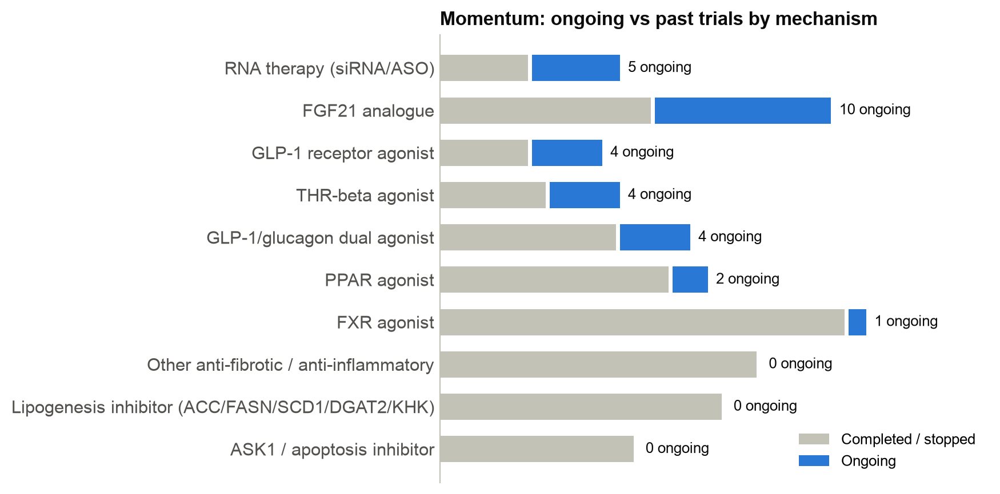
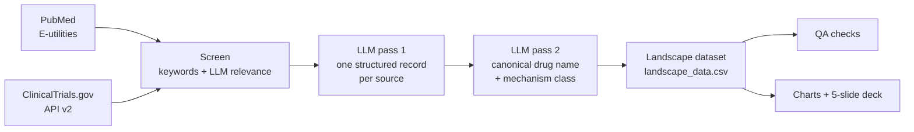

# MASH Evidence Intelligence Pipeline

**An AI-assisted pipeline that maps the competitive landscape of MASH (metabolic dysfunction-associated
steatohepatitis, formerly NASH) from public biomedical sources: PubMed and ClinicalTrials.gov.**

It collects clinical evidence, extracts structured fields from free text with an LLM, checks the
extraction quality, and turns the result into a client-ready 5-slide findings deck.

> Built as a technical case study: a European biotech preparing a €150M Series C needs to know who the key
> players in MASH are, which mechanisms dominate, and where white space exists for a new entrant.



---

## Key findings

| | |
|---|---|
| **Evidence base** | 140 peer-reviewed clinical articles (2020–2025): 95 primary trials and 45 meta-analyses |
| **Trial landscape** | 320 Phase 2/3 MASH trials; 80% Phase 2, 67% industry-sponsored, 61 still ongoing |
| **Compounds** | 429 raw drug names consolidated into 331 compounds across 26 mechanism classes |

1. **Two approved drugs set the bar.** Resmetirom (THR-β) and semaglutide (GLP-1) are approved for
   non-cirrhotic MASH. New entrants will be compared with them.
2. **FGF21 is the most crowded late-stage class.** Efruxifermin, efimosfermin and pegozafermin are in Phase 3,
   backed by 10 ongoing trials.
3. **GLP-1/glucagon multi-agonists show the most consistent efficacy.** 9 of 9 studies that reported
   results were positive; survodutide, mazdutide and pemvidutide are in Phase 3.
4. **Several early mechanisms have stalled.** FXR, ASK1, CCR2/5 and lipogenesis inhibitors account for
   55 past trials but only 2 ongoing.

**White space for a new entrant:** compensated cirrhosis (F4) has no approved therapy; only 10 of 179 trials
test two novel agents in combination; and RNA drugs against genetically validated targets (HSD17B13, PNPLA3,
CIDEB) are still mostly in Phase 2.



The full deck is in [`outputs/findings_deck.pptx`](outputs/findings_deck.pptx)
([PDF](outputs/findings_deck.pdf)).

---

## How the pipeline works



| Step | Module | What it does |
|---|---|---|
| Literature mining | [`src/pubmed.py`](src/pubmed.py) | Clinical publication types only (human, English, with abstract), stratified per year: 17 primary trials + 8 meta-analyses |
| Trial mapping | [`src/trials.py`](src/trials.py) | Interventional Phase 2/3 MASH/NASH trials, all statuses; builds a compact results summary for trials with posted results |
| LLM pass 1 | [`src/extraction.py`](src/extraction.py) | Source-grounded extraction into a Pydantic schema: drugs and their role, mechanism, endpoint, efficacy, safety, efficacy direction |
| LLM pass 2 | [`src/normalize.py`](src/normalize.py) | Unique drug names, sent in batches, mapped to a canonical INN and one of 26 mechanism classes |
| Landscape | [`src/landscape.py`](src/landscape.py) | `landscape_data.csv` (compound × source) and `compounds.csv` (one row per compound) |
| QA | [`src/validate.py`](src/validate.py) | Automated consistency checks plus a manual audit |
| Charts & deck | [`src/analysis.py`](src/analysis.py), [`src/deck.py`](src/deck.py) | Static charts and a python-pptx deck; every number is computed, none typed by hand |
| Packaging | [`src/package.py`](src/package.py) | Submission ZIP built from an allow-list (never includes `.env`) |

[`pipeline.ipynb`](pipeline.ipynb) runs these steps in order and explains each one.

### Design decisions

- **Structured data never goes through the LLM.** Phase, sponsor, status and dates come straight from the
  registry. The LLM only reads free text, which avoids, for example, `PHASE2` coming back in 15 spellings.
- **Two LLM passes.** Pass 1 sticks strictly to the source. Pass 2 works per compound and may use
  pharmacology knowledge; every such value is flagged (`moa_source = "model knowledge"`).
- **Fixed vocabularies.** Categorical fields are `Literal` enums in the schema, so there is nothing to
  normalise afterwards.
- **Drug roles.** Each drug is tagged *investigational*, *active comparator*, *background therapy* or
  *non-drug*, so vitamin E or metformin given as background therapy does not appear as a competitor.
- **Cached and capped.** Every LLM response is cached on disk under a hash of model, prompt and input, and a
  hard budget cap stops new calls once it is reached. Re-running the notebook costs nothing.

---

## LLM quality assurance

The extraction uses a low-cost model (OpenAI `gpt-6-luna`; about $0.15 for all 623 records), so its output
is checked before use:

| Check | Result | Base |
|---|---|---|
| Trial phase matches the registry | 100% | 483 trials |
| Evidence type matches PubMed publication type | 95% | 132 articles |
| Investigational drug captured when the registry lists one | 99.3% | 429 trials |
| Efficacy invented for trials without posted results | 0 | 304 trials |
| Efficacy direction consistent with reported p-values | 94% | 85 trials |
| Field accuracy in a manual audit | 94% | 13 records × 5 fields |

---

## Repository structure

```
├── pipeline.ipynb              # main notebook (runs everything)
├── src/                        # pipeline modules
├── data/
│   ├── raw/                    # pubmed_data.json, trials_data.json (raw API records)
│   ├── processed/              # LLM extraction, drug map, compound table
│   └── cache/                  # cached LLM responses (re-runs are free)
├── outputs/
│   ├── landscape_data.csv      # structured landscape, one row per compound × source
│   ├── findings_deck.pptx/.pdf # 5-slide findings deck
│   └── figures/                # charts used in the deck
└── requirements.txt
```

---

## Running it

```bash
git clone git@github.com:afroozmohandesian/mash-evidence-pipeline.git
cd mash-evidence-pipeline
python -m venv .venv && source .venv/bin/activate
pip install -r requirements.txt
echo "OPENAI_API_KEY=sk-..." > .env     # only needed for records that are not cached
jupyter lab pipeline.ipynb              # Run All
```

- With the committed cache, *Run All* reproduces every result without any API calls.
- Set `REFRESH_SOURCES = True` in the first code cell to pull fresh data from PubMed and ClinicalTrials.gov;
  new records are then sent to the LLM within the `LLM_BUDGET_USD` cap (default $0.60).
- Optional environment variables: `LLM_MODEL`, `LLM_BUDGET_USD`, `NCBI_EMAIL`, `NCBI_API_KEY`.

---

## Limitations

- PubMed is a stratified sample of top-relevance clinical articles (about 25 per year), not a census.
- Registry status on ClinicalTrials.gov can lag reality.
- Mechanism classes for compounds whose source does not state a mechanism come from model knowledge
  (flagged); unrecognised compounds are labelled *Unknown* rather than guessed.
- `efficacy_direction` is a coarse label based on the primary endpoint.
- The regulatory context in the deck (FDA approvals of resmetirom in 2024 and semaglutide in 2025) is
  external knowledge, not pipeline output.

## Data sources

- [PubMed](https://pubmed.ncbi.nlm.nih.gov/) via NCBI E-utilities
- [ClinicalTrials.gov](https://clinicaltrials.gov/) API v2

Both are public. This repository contains no proprietary or personal data.
